<p align="center">
  
</p>

<h1 align="center">DevOS</h1>

<p align="center">
  <b>A familiar Linux desktop with Windows and Android compatibility tools, developer apps and local AI.</b><br>
  Source targets Ubuntu 26.04 LTS · Open source (MIT) · Made by <a href="https://imrandev.bd/">Imran Ahmed (Imran Dev)</a>
</p>

<p align="center">
  <a href="https://drive.google.com/drive/folders/1RHM8niXwkPsqzOkiMxxp4tpf41bnyJ01?usp=sharing">
    
  </a>
</p>

<p align="center">
  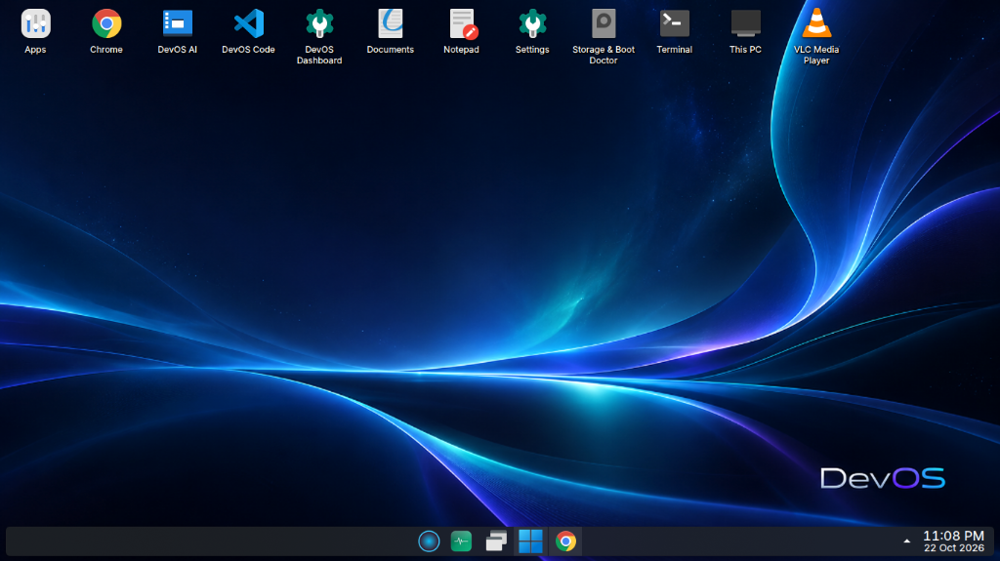
  <br><em>DevOS Desktop featuring Sapphire Waves wallpaper, centered taskbar with AI Assistant, Start launcher, system tray, and Windows-familiar workflow.</em>
</p>

---

## Current source — October 22, 2026

The source targets **Ubuntu 26.04 LTS (Resolute Raccoon), amd64**. Ubuntu's
26.04.1 point release is available; standard support for the Ubuntu base runs
through May 2031. That schedule does not extend automatically to DevOS tools or
third-party apps. See [Ubuntu's release list](https://ubuntu.com/project/docs/release-team/list-of-releases/).

Read the [complete current feature inventory](docs/FEATURES.md),
[latest changes](CHANGELOG.md), and [update guide](docs/UPDATES.md).
The Google Drive link is for previously published images; source screenshots and
features below do not certify that an older download contains the latest changes.
Build output is `out/devos-26.04-amd64.iso`; verify the checksum supplied with the image.

**Recently added and improved**

- **Sign-in screen:** centered dark card, readable password field, show-password control,
  account/session selection, clock/date, login feedback and restart/shutdown controls.
- **Broadband Connection:** connect or disconnect a direct ONU/modem with ISP PPPoE
  credentials; NetworkManager configuration prevents duplicate automatic wired profiles.
- **Files and storage:** Windows-style This PC, tabs, properties, new file/folder dialogs,
  ZIP/7z context menus, unformatted drive discovery and partition formatting in Storage Doctor.
- **Display and Power & sleep:** resolution/refresh controls, display scaling, separate
  battery/plugged-in timeouts and power profiles. Available controls depend on the session
  and hardware; native Plasma settings remain useful for Wayland-specific controls.
- **AI Code Agent:** prompt queue, cancellation, retry/rerun, project runner and preview,
  persistent development servers, repository context, and optional cloud providers.
- **Desktop polish:** DevOS Start-menu branding, compact fonts/taskbar, Sapphire Waves
  and additional wallpapers, dashboard onboarding, improved application names in Optimizer,
  and an emoji panel that stays closed until requested.

<p align="center">
  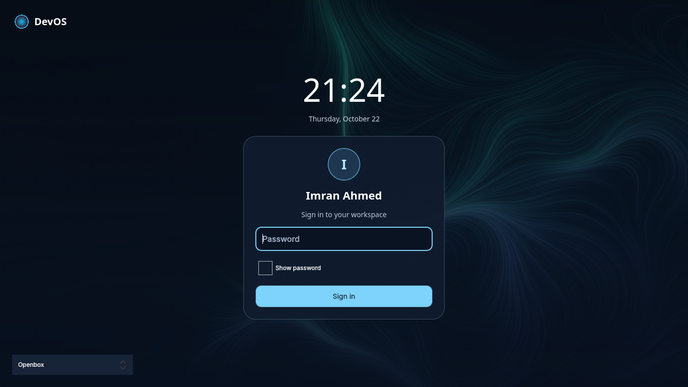
  <br><em>Rendered SDDM theme preview with sample account/session data; not an installed-system boot screenshot.</em>
</p>

<p align="center">
  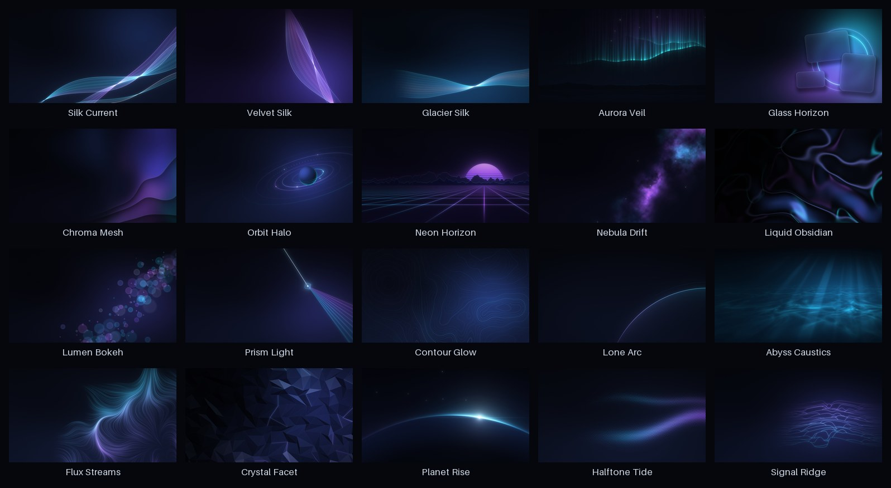
  <br><em>DevOS wallpaper collection. Desktop and dashboard screenshots elsewhere in this README show earlier source builds.</em>
</p>

## Our aim

DevOS exists to give people — especially Windows users and developers — **an operating system that feels familiar on day one, stays fast on ordinary laptops, and respects their privacy**:

- **Run what you already use.** Open supported Windows `.exe`, Android `.apk` and Linux apps from one desktop; compatibility varies by application. When a better native version of the app exists, DevOS offers it.
- **Stay fast on modest hardware.** A size-limited ISO build, a small on-device AI that gives its memory back when idle, compressed memory and storage, and a built-in optimizer.
- **AI that works for you, privately.** DevOS AI runs entirely on your PC: it answers questions about your computer, does things for you (open apps, search, save notes, set reminders…), reads PDFs and images, and understands your voice in Bangla and English using local processing. Optional web searches, backups and cloud code-agent providers use the network.
- **Premium, simple, and yours.** A polished dark design, a guided installer with no online account required, and no telemetry.

---

## Highlights

| | |
|---|---|
| 🪟 **Windows apps** | `.exe` / `.msi` open with a double-click (32- and 64-bit). Popular apps such as AnyDesk, Zoom, Discord, Spotify and Steam get their **native DevOS version** offered instead. |
| 🤖 **Android apps** | `.apk` files install into a built-in Android system (downloaded once on first use, ~850 MB). WhatsApp, Telegram, Spotify and similar APKs are offered as native DevOS apps — no Android download needed. |
| ✨ **DevOS AI** | Private on-device assistant: PC questions, actions, notes, web search, reminders, PDFs, text-in-images, photos, voice (Bangla + English), Islamic daily Ayah & Hadith with Muhiuddin Khan Bangla translation, **Meta+H** push-to-talk and optional **“Hey DevOS”**. |
| 🌙 **Islamic & Modesty** | Authentic Quran & Hadith with verified **Muhiuddin Khan Bangla translation** & Arabic, offline prayer times & Qibla. Intelligent on-device modesty filter for Chrome/Brave/Edge with selectable detection modes and text-image exclusions. Detection can miss content or blur it incorrectly. |
| 🧹 **DevOS Optimizer** | Finds apps you haven't used for 15+ minutes and offers to close them (with real app names like *This PC*, *Notepad*); cleans temp files, caches, the Recycle Bin and Windows-app leftovers. |
| 🚀 **Kids Mode** | Safe cosmic playground with interactive mouse-play physics (`devos-kids-mode`); children can play safely while background jobs keep running. |
| 📦 **Apps window** | Windows-style *Installed apps*: uninstall Linux, Windows and Android apps, clear cache, reset data and browser cookies. |
| 📝 **Notepad** | Windows 11-style tabs; **unsaved text survives crashes and power cuts**. |
| 💻 **Developer ready** | VS Code, Git, Node.js, Python, PHP + Composer, MariaDB, PostgreSQL, Redis, SQLite, Podman (Docker-compatible). |
| 🎨 **Premium look** | Dark DevOS theme, icons-only taskbar, **25+ wallpapers**, a modern installer, DevOS names everywhere (Files, Terminal, Settings…). |
| ⚡ **Small & fast** | ISO size checked during build; boots straight to the desktop, compressed RAM swap, btrfs + zstd storage, memory-hog protection. |

---

## What you get

### 1. Installer
- Guided Calamares installer: welcome, location, keyboard, disk, local account, AI model, user type, apps, summary and progress.
- **Erase disk** creates an EFI partition plus a btrfs system (subvolumes for `/`, `/home`, `/.snapshots`, `/var/log`, `/var/cache`; zstd compression). Manual partitioning and full-disk encryption (LUKS) are available too.
- **A local account is created; no online account is needed.** Account details are pre-filled; leave the password empty and DevOS signs in automatically (you can add a password later).
- Boots on **UEFI and legacy BIOS** PCs, from USB or DVD. After install it starts **straight to the desktop** — no boot menu wait (the menu still appears when Windows is installed alongside).

### 2. Desktop that feels like Windows
- Start menu with the DevOS logo, **icons-only taskbar** with separate entries for open windows, system tray and clock.
- Desktop shortcuts: Apps, Chrome, DevOS AI, DevOS Code, Documents, Notepad, Settings, Terminal, This PC, VLC and more.
- **Files & This PC (`devos-files`, `devos-archive`)**: Windows-style drive overview, multi-tab navigation, quick access, breadcrumb path bar, properties dialog, and one-click ZIP/7z context menu archive creation & extraction.
- **Windows keyboard shortcuts**

  | Keys | Action |
  |---|---|
  | `Win` | Start menu |
  | `Win + E` | Files (file explorer) |
  | `Win + D` | Show desktop |
  | `Win + R` | Run / search |
  | `Win + L` | Lock |
  | `Win + Shift + S` | Screenshot of a region |
  | `Win + ← → ↑ ↓` | Snap / maximise / minimise windows |
  | `Win + H` | **DevOS AI voice command** |
  | `Win + V` | **Clipboard history** — pick something you copied and paste it back |
  | `Win + .` | **Emoji** — search and paste a smile, a heart, food, or the Bangladesh flag |
  | `Win + Alt + H` | **Voice typing** into the app you are using |
  | `Win + Alt + A` | **AI on selected text** — rewrite, fix, shorten, translate, summarize |
  | `Ctrl + Shift + Esc` | **Task Manager** |

- **25+ wallpapers**: the new DevOS Sapphire Waves default plus flagship designs (Golden Cloudscape, Cosmic Orbit, Alpine Floral Terrace, Kids Learning Room, Aurora Veil, Silk Current, Nebula Drift…), with previews in *Configure Desktop and Wallpaper*. See [`tools/wallpapers/preview.jpg`](tools/wallpapers/preview.jpg).
- **Night light** warms the screen from 7:00 pm to 6:30 am, the way Windows does, and leaves daytime colour alone. Turn it off in Settings → Display & Monitor → Night Light.
- **Your work comes back.** After a restart or shutdown, DevOS opens the same applications again. Browsers reopen their tabs, Notepad and DevOS Code reopen the same files (including unsaved text), and Files, Terminal, Kate and the other KDE apps reopen the documents that were on screen.
- Everything is called **DevOS**: the sign-in session, “About this PC”, and apps named by what they do — *Files, Terminal, Text Editor, Photos, Document Viewer, Settings, Task Manager*.

### 3. Application compatibility

#### Windows programs (`.exe`, `.msi`)
- Double-click to run. Each app gets its own isolated Windows environment, prepared **silently** the first time (no technical pop-ups) and copied instantly for every new app on btrfs.
- 32-bit installers (most setup files) and 64-bit programs are supported.
- **Native versions first:** for AnyDesk, Zoom, Discord, Spotify, Telegram, WhatsApp, Steam, OBS, Slack, Firefox, Brave, GIMP, Blender, Audacity, LibreOffice, Postman and TeamViewer (Remmina), DevOS offers to install the **DevOS (native) version** from Flathub — faster and fully featured (e.g. AnyDesk's remote control only works natively). You can still run the Windows version.

#### Android apps (`.apk`)
- Double-click an APK: on first use DevOS asks once to download the Android system (~850 MB, shown with a real progress bar, resumable and checksum-verified), then installs and opens the app in a **DevOS Android** window. Installed apps appear in the app menu.
- Works on Intel and AMD graphics; other GPUs and virtual machines automatically use software rendering.
- Popular apps with native versions (WhatsApp, Telegram, Spotify, Discord, Zoom…) skip the Android download entirely.

#### Linux apps
- Thousands of apps from **Flathub** (preconfigured), plus `.deb` packages and AppImages.

#### Apps window — uninstall and clean
- One list of every installed app (Linux, Windows, Android) with search, sort by size and type filter.
- **Uninstall**, **Clear cache**, and **Reset data & cookies** (for browsers: cookies and cache, optionally history, passwords and bookmarks). System parts are protected from removal.
- Right-click any app shortcut → **Uninstall…**

<p align="center">
  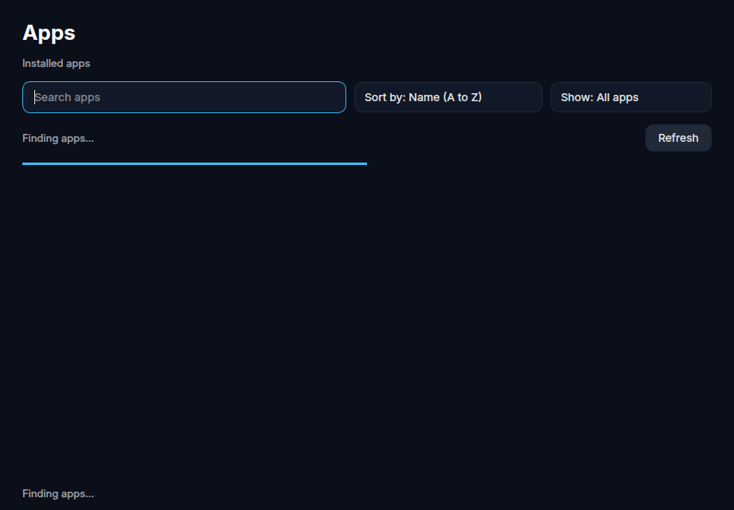
  <br><em>DevOS Installed Apps: unified management, cache cleanup, and storage & cookie reset for Linux, Windows, and Android applications.</em>
</p>

### 4. DevOS AI — your private assistant
Open **DevOS AI** from the desktop, or press **Win + H** and just speak.

**Ask about your PC** — “What's my PC config?”, “How much RAM?”, “How many apps are installed?” — answered from real system data, not guesses.

**Tell it what to do** (typed or spoken, typos are fine):

| Say or type | DevOS AI does |
|---|---|
| “Go to Chrome and search HP latest laptop” | Opens Chrome with that Google search |
| “Play lo-fi music on YouTube” / “Directions to Dhaka airport” | YouTube / Maps search |
| “Open Notepad and save my name Imran Ahmed, number 0151…” | Saves a note in *Documents/Notes* and opens it |
| “Take a note: buy milk, eggs and bread” | Same, as a note |
| “Remind me in 10 minutes to call mom” / “Set a timer for 5 minutes” | Desktop reminder, even if the window is closed |
| “Send an email to x@y.com about the meeting” | Opens a ready email draft (never sends by itself) |
| “Open my Downloads” / “Make a folder called Projects on the desktop” | Files and folders |
| “Open Wi-Fi settings”, “Volume up”, “Brightness down”, “Take a screenshot”, “Lock the screen” | Settings and system actions |
| “Close Chrome”, “Free up space”, “Open Apps” | App and cleanup actions |
| “Today's Islamic” / “Today's ayah” / “আজকের আয়াত” | Shows authentic Quran Ayah & Hadith of the day with Arabic, English, and **Muhiuddin Khan Bangla translation** directly from verified local datasets with zero AI hallucination |
| “Help me, Wi-Fi is not working”, “Is my PC safe?”, “Is this link safe?” plus the address | Checks this PC and does the safe next step |

Shut down, restart and uninstall always ask for confirmation first.

**Documents & images**
- Attach a **PDF**, Word file or text file and ask “Summarize this” or a question about it.
- **Read text in images** (English + Bangla) instantly, no download.
- **Describe photos** (“What's in this picture?”) with an optional one-time download (about 520 MB including the vision model assets).

**Voice**
- Offline speech recognition for **Bangla and English** (included in the ISO).
- **Win + H**: speak a command; a small pill shows what was heard and the result.
- **“Hey DevOS”** hands-free mode (off by default, one switch in the sidebar), with battery and CPU guards and a tray icon to pause it.

**Experience**
- Modern chat window: conversation history sidebar with search, rename and delete; answers stream in word by word; Stop button; copy and regenerate; drag-and-drop files.
- **Starter Cards:** One-click suggestion cards for common actions on new chats (*Today's Islamic*, *What's my PC config?*, *How many apps are installed?*, *Start kids mode*).
- **Fast and light:** the built-in model is small (0.5B, ~490 MB); response speed depends on your hardware, and its memory is **released after 5 idle minutes**.
- **Smarter DevOS AI:** one click adds a larger model (1.1 GB) for better free-form answers; one click removes it again.
- **Local assistant:** chat, speech and document processing run on this PC. Web actions open online services; the separate Code Agent can use configured cloud providers.
- Also available to apps: an OpenAI-compatible local API at `http://127.0.0.1:11434/v1` (used by DevOS Code's AI features). Reference: `http://127.0.0.1:11434/docs` and [`docs/LOCAL_AI.md`](docs/LOCAL_AI.md).

### 5. DevOS Optimizer
- Tray app that watches for apps you haven't used for 15+ minutes and that use a lot of memory, and offers **Close / Keep / Don't ask again** (never touches system processes).
- **Real app name resolution:** Accurately identifies applications by their desktop launcher and command line (e.g., *This PC*, *DevOS Notepad*, *DevOS Notes*) instead of generic runtime names like `python3`.
- **Clean up**: temporary files, app and browser caches, Recycle Bin, Windows-app temp files, old crash logs, and (optionally) old downloads — with sizes shown first and a confirmation.
- Low disk space warnings, and an **Ask DevOS AI** button for tips based on what's using your PC.

### 6. Notepad
- Tabs, find & replace, go to line, zoom, word wrap, line/column status bar — like Windows 11 Notepad.
- **Never lose text:** every tab (including unsaved *Untitled* ones) is saved automatically and restored after a crash, a forced close or a power cut.

### 7. For developers & AI Engineers
- **DevOS AI Code Agent**: Autonomous pair programming and development agent with repository planning, interactive diff reviews, prompt queuing, cancellation, retry/rerun, live dev server preview, and terminal execution (`devos-ai-code-agent` or desktop shortcut). Supports both local offline LLMs and optional cloud providers (Google Gemini, Groq, DeepSeek, OpenAI).

<p align="center">
  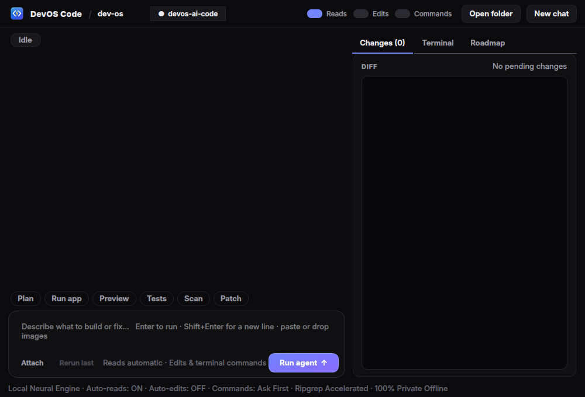
  <br><em>DevOS AI Code Agent: autonomous pair programming, step-by-step execution plans, interactive diff review, terminal execution, and local/cloud LLM routing.</em>
</p>

- **Local AI Code Agent & Engine**: Hardware-accelerated local inference API listening at `http://127.0.0.1:11434/v1` (OpenAI & Ollama compatible). Zero telemetry, 0 token costs, 100% offline. Pre-wired into VS Code via Continue (Ctrl+L).
- **Windows 11 Fluent Task Manager**: Modernized system performance and resource monitor (`Ctrl + Shift + Esc`) with anti-aliased gradient utilization curves, clean KPI cards, friendly network interface mapping (`Ethernet`, `Wi-Fi`, `Virtual Bridge`), and colored status badges.
- **Self-Hosting Day-by-Day OS Development**: Develop and customize DevOS directly while using it as your daily operating system. Native Python/Qt components live directly under `/usr/local/share/devos/components/` — edit code in VS Code, hit Save, and your changes take effect instantly. Backed by automatic Btrfs/Snapper instant rollback snapshots.
- **Full Developer Stack**: VS Code (“DevOS Code”), Git, Git LFS, GitHub CLI, Node.js + npm, Python 3 + pip/venv/pipx, Ubuntu-provided PHP (FPM + common extensions) + Composer, MariaDB, PostgreSQL, Redis, SQLite, Podman / podman-compose (Docker-compatible), Neovim, tmux, ripgrep, fzf, btop, jq.
- `devos serve` scaffolds Laravel, Next.js and FastAPI projects and shows the status of local services.

### 8. Performance and reliability
- **zram** compressed swap in RAM (zstd, 50%) and tuned kernel settings for heavy loads.
- **earlyoom + systemd-oomd** stop runaway programs before the desktop freezes.
- **btrfs with zstd compression** saves disk space and is snapshot-ready (Snapper installed).
- Unneeded services (snapd, apport, telemetry) are removed or masked; boots straight to the desktop.

### 9. Hardware, Networking & Display
- **Broadband Connection (`devos-broadband`)**: Dedicated dial-up app for direct ONU / fiber modems requiring ISP PPPoE credentials. Includes automatic reconnection, service name and MTU customization, live connection state monitoring, and automated NetworkManager configuration that prevents duplicate wired connections.

<p align="center">
  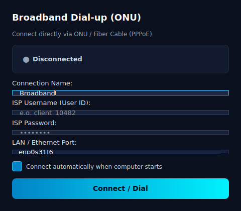
  <br><em>DevOS Broadband Connection: direct ONU/modem PPPoE dial-up configuration with credentials, MTU tuning, and connection monitoring.</em>
</p>

- **Display & Scale (`devos-display`)**: Resolution selection, refresh rate controls (up to 144Hz+), and display UI scaling (100%, 125%, 150%, 200%) with a safety keep/revert countdown timer.
- **Power & Sleep Management (`devos-power`)**: Separate battery vs plugged-in idle timeouts, power modes (Performance, Balanced, Power Saver), screen blanking, sleep, hibernate, and shutdown.
- **Peripherals & Drivers**: Wi-Fi and Ethernet (NetworkManager), Bluetooth integration, PipeWire low-latency audio, printers and scanners (CUPS / IPP), Intel and AMD graphics (Mesa + Vulkan), NVIDIA proprietary drivers via driver manager, and broad hardware firmware.

### 10. Choose your DevOS AI (at install time)
- A **“Choose your DevOS AI”** page in the installer measures the PC (RAM, processor, disk) and pre-selects the model that fits: **Tiny 0.5B** (built in) · **Small 1.5B** (1.1 GB, 4 GB RAM) · **Medium 3B** (2.1 GB, 8 GB RAM) · **Large 7B** (4.7 GB, 16 GB RAM) · **Extra large 14B** (9 GB, 32 GB RAM). Models that would make the PC slow are greyed out.
- Extras: **Photo understanding** (520 MB) and a **Coding model** (`devos-ai-code`). Reading PDFs and text in images (Bangla + English) and voice work with every choice.
- The ISO stays small: the chosen model downloads by itself after install once the PC is online (resumes after interruptions). Change it any time in **DevOS AI Models** or with `devos-ai-models`.

<p align="center">
  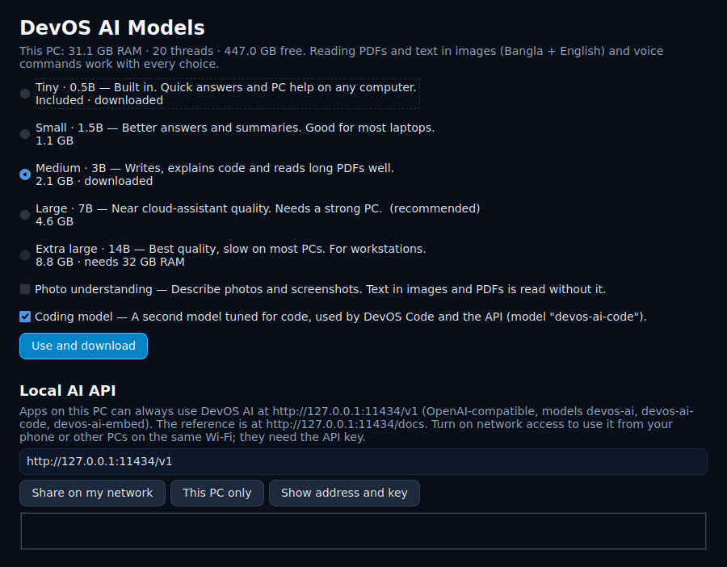
  <br><em>DevOS AI Models Manager: choose on-device AI models, manage vision/coding weights, and share local OpenAI API across the network.</em>
</p>

### 10b. Choose your apps (at install time) — and DevOS Features afterwards
- An installer page **“Choose your apps”** works like Windows’ optional features plus an app bundle installer. Start with **Normal**, **Professional**, **Student**, **Development**, **Creator**, **Gamer**, **Business**, **Family**, **Normal + Islamic**, or **Premium**, then tick or untick apps. **Windows-like**, **Minimal**, and **Choose later** are also available as feature presets. Family Safety and the modesty filter stay off until chosen.
- Unticked built-ins are removed during install (no internet needed); ticked apps download on the first online boot, with a notification when they’re ready. Office files then open with a double-click in the suite you picked.
- **DevOS Features** (Start menu) adds or removes any of these later and sets **Default apps** (browser, email, documents, spreadsheets, PDF, music, video, photos). From the terminal: `devos-features list`, `sudo devos-features set --add zoom,gimp`.
- **Normal + Islamic** includes the everyday set, prayer times, Family Safety and the modesty filter.
- **Normal** filters heavier downloads by RAM and disk size and selects a lighter office suite when appropriate.

<p align="center">
  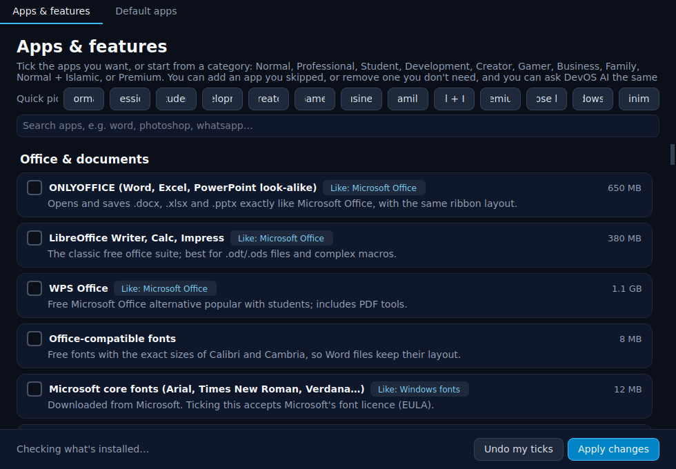
  <br><em>DevOS Features: Windows-style optional components, bundled app selection, and default application associations in one view.</em>
</p>

**Availability:** preset selections are not an offline bundle. Apps in the tables below download after installation unless explicitly identified as built in. Chrome and VS Code are fetched during the build, with online installation helpers available if absent. Web-app shortcuts require internet and their provider accounts. The [feature inventory](docs/FEATURES.md) lists delivery for every catalog entry.

**Office**

| Feature | What it does | Included with |
|---|---|---|
| ONLYOFFICE | Word, Excel and PowerPoint look and files, with the same ribbon | Windows-like, Student, Developer, Creator, Gamer |
| LibreOffice | Writer, Calc and Impress; best for `.odt` / `.ods` and macros | Student |
| WPS Office | Office alternative popular with students, including PDF tools | Add in DevOS Features (4 GB RAM) |
| Office-compatible fonts | Carlito and Caladea, so Word files keep Calibri and Cambria sizes | Every preset |
| Microsoft core fonts | Arial, Times New Roman, Verdana and the rest (Microsoft’s font licence) | Windows-like, Student |
| PDF tools | Merge, split and rotate (PDF Arranger); write, highlight and sign (Xournal++) | Windows-like, Student, Developer, Creator, Gamer |
| Joplin | Notes and to-dos with sync, like OneNote | Student (4 GB RAM) |
| Obsidian | Markdown notes and a knowledge base | Add in DevOS Features (4 GB RAM) |
| Calendar & reminders | Calendar with alarms, like Outlook Calendar | Add in DevOS Features |
| XMind | Mind maps and brainstorming | Add in DevOS Features (4 GB RAM) |

**Internet**

| Feature | What it does | Included with |
|---|---|---|
| Google Chrome | Chrome with Google sign-in. Build-time download; online helper if absent | Every everyday preset |
| Microsoft Edge | Edge with a Microsoft account | Windows-like (4 GB RAM) |
| Firefox | Private, open-source browser | Add in DevOS Features |
| Brave | Browser with built-in ad blocking | Add in DevOS Features (4 GB RAM) |
| Thunderbird | Email and calendar for Gmail, Outlook.com and work accounts | Windows-like, Student |
| Windows App | Microsoft’s own app for Windows 365, Azure Virtual Desktop and remote apps | Windows-like, Developer |
| Microsoft 365 online | Word, Excel, PowerPoint and OneDrive in their own window | Windows-like, Student |
| Outlook online | Outlook mail and calendar in its own window | Windows-like |
| qBittorrent | Torrent downloads | Add in DevOS Features |

**Chat**

| Feature | What it does | Included with |
|---|---|---|
| WhatsApp | WhatsApp for desktop | Windows-like, Student |
| Zoom | Video meetings | Student (4 GB RAM) |
| Microsoft Teams | Teams for work and school | Add in DevOS Features (4 GB RAM) |
| Telegram | Telegram Desktop | Add in DevOS Features |
| Discord | Voice and text chat | Gamer (4 GB RAM) |
| Slack | Team chat | Add in DevOS Features (4 GB RAM) |
| Signal | Private messaging | Add in DevOS Features (4 GB RAM) |
| KDE Connect | Phone notifications, clipboard and files. Built in | Every everyday preset |

**Media, photos and video**

| Feature | What it does | Included with |
|---|---|---|
| VLC | Plays every music and video format. Built in | Every everyday preset |
| Spotify | Music streaming | Windows-like, Student (4 GB RAM) |
| Camera | Photos and video from the webcam | Windows-like, Student |
| Paint | Drawing and simple image editing, like MS Paint | Windows-like, Student, Developer, Creator, Gamer |
| GIMP | Photo editing, like Photoshop | Creator (4 GB RAM) |
| Krita | Digital painting | Creator (6 GB RAM) |
| Inkscape | Vector graphics, like Illustrator | Creator (4 GB RAM) |
| Kdenlive | Video editing, like Clipchamp | Creator (8 GB RAM) |
| OBS Studio | Screen recording and live streaming | Creator, Gamer (6 GB RAM) |
| Audacity | Record and edit audio | Creator |
| Blender | 3D modelling and animation | Add in DevOS Features (8 GB RAM) |
| HandBrake | Convert and shrink videos | Add in DevOS Features (4 GB RAM) |

**Games**

| Feature | What it does | Included with |
|---|---|---|
| Steam | Steam games, with Proton for Windows games | Gamer (8 GB RAM) |
| Heroic | Epic Games, GOG and Amazon libraries | Gamer (6 GB RAM) |
| Lutris | Game manager for many stores and emulators | Add in DevOS Features (4 GB RAM) |
| ProtonUp-Qt | Newer Proton and Wine versions for games | Gamer |

**Developer**

| Feature | What it does | Included with |
|---|---|---|
| Visual Studio Code | DevOS Code, with DevOS AI chat and autocomplete. Built in | Windows-like, Student, Developer, Creator, Gamer |
| Web servers & databases | PHP, MariaDB, PostgreSQL and Redis, like XAMPP. Built in | Windows-like, Student, Developer |
| Postman | Test web APIs | Developer (6 GB RAM) |
| DBeaver | MySQL, PostgreSQL and other databases | Developer (6 GB RAM) |
| GitHub Desktop | Git with a simple window | Developer |
| Android Studio | Build Android apps | Add in DevOS Features (16 GB RAM) |

**Tools**

| Feature | What it does | Included with |
|---|---|---|
| Disk usage map | See what fills the disk (Filelight) | Windows-like, Student, Developer, Creator, Gamer |
| AnyDesk and RustDesk | Help or get help on another PC | Windows-like (4 GB RAM) |
| Remmina | Remote Desktop to a Windows PC, Windows 365 or Azure Virtual Desktop | Windows-like, Student, Developer |
| Scanner | Scan a document to PDF | Windows-like, Student |
| Timeshift | One-click system restore points, like System Restore | Windows-like, Student, Developer, Creator, Gamer |
| Accessibility | Screen reader (Orca), magnifier (KMag) and on-screen keyboard. Built in | Every preset |
| Warehouse | Update, roll back and clean up Flathub apps | Add in DevOS Features |

**Security and sign-in**

| Feature | What it does | Included with |
|---|---|---|
| Firewall | Incoming connections blocked. Phone Link, KDE Connect and DevOS Share still work | Every preset |
| ClamTk | A classic scanner window for a manual scan. Everyday protection is DevOS Security | Windows-like (4 GB RAM) |
| KeePassXC | Offline password vault | Student, Developer |
| Bitwarden | Password manager with sync | Add in DevOS Features (4 GB RAM) |
| Fingerprint sign-in | Like Windows Hello, on laptops that have a reader. The password still works | Every preset |
| Company network | Join an Active Directory domain | Add in DevOS Features |

**Language**

| Feature | What it does | Included with |
|---|---|---|
| Bangla typing | Avro phonetic: type Bangla on an English keyboard (`ami` → আমি). Switch with Ctrl+Space | Windows-like, Student, Developer, Creator, Gamer |
| Fonts for all languages | Noto fonts so sites and documents render. Built in | Every preset |

**Windows and Android apps**

| Feature | What it does | Included with |
|---|---|---|
| Windows apps | Double-click `.exe` and `.msi`. DirectX 9–11 uses DXVK | Every preset |
| Windows virtual machine | Programs Wine cannot run, such as kernel anti-cheat. You supply your own Windows ISO and licence | Windows-like, Gamer (8 GB RAM) |
| Bottles | Ready-made setups for popular Windows programs | Gamer (4 GB RAM) |
| Android apps | Double-click an `.apk`. The Android system downloads once (~850 MB) | Windows-like, Student, Developer, Creator, Gamer (4 GB RAM) |

**Built in with DevOS** (no download; hide one in DevOS Features and tick it again later)

| Feature | What it does |
|---|---|
| DevOS AI | Private assistant: PC questions, actions, notes, search, reminders, PDFs, photos, voice. Win+H |
| DevOS AI Models | Pick a larger model, photo understanding, or the coding model. Share the API on your Wi-Fi |
| DevOS AI API | OpenAI-compatible local API and docs at `http://127.0.0.1:11434/docs` |
| AI on any text | Select text, press Win+Alt+A: rewrite, fix grammar, shorten, translate, summarize, reply |
| Voice typing | Dictate into any app in Bangla or English. Win+Alt+H. Offline |
| Clipboard history | Win+V. Pick an earlier copy and paste it back |
| Emoji panel | Win+. Search smile, love, food or `bd` |
| DevOS Notes | Notebooks, sticky notes, voice notes, AI summarize / to-do / translate |
| Notepad | Tabs, and unsaved text survives a crash or power cut |
| DevOS AI Code Agent | Cursor-style agent on the local model. 8 GB RAM and a Medium or Coding model |
| AI agent browsers | One Chrome profile per agent, only as many as this PC can keep smooth |
| Coding automations | `devos auto commit`, `review`, `explain`, `summarize`, `hook` |
| DevOS Optimizer | Close idle memory-heavy apps; clean temp files, caches and the Recycle Bin |
| Apps | Installed apps: uninstall, clear cache, reset data and cookies |
| App Hub | Paste a Store, Play, App Store or Flathub link, or say “install Zoom” |
| Task Manager | Processes, performance, startup apps, users and services. Ctrl+Shift+Esc |
| DevOS Security | Virus scan, phishing and scam checks, firewall, updates, Disk Guard |
| Disk Guard | Names a program filling the disk and can pause it |
| Restore points | btrfs snapshots, including one before package updates |
| DevOS Vault | Encrypt a folder with a password after install |
| Phone Link | Control this PC from the phone’s browser |
| DevOS Share | A public `https://` link for an app running on this PC |
| Cloud Backup | Optional Google Drive or OneDrive backup of your folders |
| Dashboard | PC overview in its own window |
| Storage Doctor | What is using the disk, with a way to clean it |
| Settings, Files, This PC, Terminal, Photos | The everyday desktop, named as what they do |
| Night light | Warmer screen from 7:00 pm to 6:30 am |
| Islamic DevOS | Prayer times, Qibla, Hijri date, daily ayah and hadith. Islamic family preset |
| Family Safety | Blocks adult content, forces SafeSearch and YouTube Restricted mode. Islamic family preset |
| Modesty filter | On-device blur of images and videos showing women, or all people. Islamic family preset |

### 11. Local AI API — automatic, fast, documented
- DevOS AI is always available to your own apps as an **OpenAI-compatible API** at `http://127.0.0.1:11434/v1` (models `devos-ai`, `devos-ai-code`, `devos-ai-embed`) — no key on this PC. Open **DevOS AI API** in the start menu, browse `http://127.0.0.1:11434/docs`, or read [`docs/LOCAL_AI.md`](docs/LOCAL_AI.md). A machine-readable spec is at `http://127.0.0.1:11434/openapi.json`.
- The service tunes itself for this PC: prompt processing uses every processor thread, replies use one thread per physical core, flash attention and a compact KV cache when the engine supports them, and the CPU steps up to full speed while a reply is generating. GPU layers are used when the hardware supports them. `curl http://127.0.0.1:11434/health` shows the choice.
- One switch (**DevOS AI Models → Share on my network**, or `devos-ai-models api lan on`) lets phones and other PCs on the same Wi-Fi use it with an API key.
- **Coding automations** on the same model: `devos auto commit` (subject from the staged diff), `devos auto review`, `devos auto explain` (an error on stdin), `devos auto summarize file`, and `devos auto hook` (fills an empty git commit message). They never commit or run commands by themselves.
- **Many AI agent browsers at once.** Each agent gets its own Chrome profile, so they do not join one window or lock each other. Each one has a memory ceiling and an equal share of the CPU, and a new one starts a fraction of a second after the last so the disk is not hit all at once. DevOS starts only as many as this PC can keep smooth (about ten on 8 GB, up to 32 on a large PC) and leaves the desktop's own Chrome alone. A disguised or short address is not opened. `devos agents capacity`, `devos agents open research --url https://example.com`, `devos agents open-many research writer mail`, `devos agents close research`.

### 12. Phone Link — control the PC from your phone
- Open **Phone Link**, scan the QR code with your phone’s camera — no app needed. From the phone: live PC stats, lock, volume, media keys, open apps, send text to the clipboard, send files to the PC (`Downloads/Phone`), download your files, see a screenshot, ask DevOS AI, sleep/shut down (with confirmation).
- One-time pairing codes (expire in 5 minutes), per-phone keys you can remove, off until you turn it on. Port **8765** on your home network.
- Prefer a native app with notifications and clipboard sync? **KDE Connect** is included — install KDE Connect on Android/iPhone.

### 13. DevOS Share — show your local app to the world
- Running `npm run dev`, Laravel or any local server? Open **DevOS Share**, click **Make public** and get a public `https://…` link (plus a QR code) — **no domain, no account, no router setup**. Works even behind the shared IPs (CGNAT) most mobile and home internet uses.
- Providers: Cloudflare Quick Tunnel (downloaded on first use), localhost.run over SSH, or **Direct (my IP)** via UPnP when your router and ISP allow it — DevOS tells you if they don’t.
- From the terminal: `devos share start 3000`, `devos share list`, `devos share stop all`.

### 14. DevOS Security — layered protection, on by default
- One window like Windows Security, with a score and one-click **Fix** buttons. No security software can promise to stop every threat, so DevOS stacks several layers instead:
  - **Virus protection (ClamAV):** every finished download (browsers, WhatsApp, Telegram, inside zip/rar/7z), USB drives, and Windows `.exe`/`.msi` and Android `.apk` files before they run. Threats go to a locked **Quarantine** and can't be started from there. 8 GB+ PCs scan instantly (clamd); smaller PCs scan in short low-priority batches so the PC stays fast. Signatures update every 6 hours.
  - **Web protection:** Quad9 security DNS blocks known phishing, malware and scam sites for every app. Chrome, Edge, Brave and Firefox block dangerous downloads and warn about leaked passwords, and they do not offer a button to continue to a site they have already marked dangerous. Firefox shows look-alike names in punycode.
  - **Look-alike links and scam messages:** checked on this PC, with no extra program running. DevOS AI will not open a disguised address or a short link. A phishing page saved to Downloads or a USB drive is quarantined before the virus scanner loads, so a small PC does not spend memory on a file that is already obviously a fake. Check one yourself: `devos-security check https://example.com`, or `devos-security check --text` for a message. A brand-new site with an ordinary name can still get through until it is on a threat list.
  - **Firewall** on, **automatic security updates** (DevOS asks when a restart is needed; a person chooses when to restart), AppArmor sandboxing. A critical battery puts the PC to sleep, so open documents stay open.
  - **Disk Guard:** catches a runaway app or bug filling the disk, names the file and the program writing it, offers Pause / Stop, and pauses it automatically when space is critically low. System logs and crash dumps are size-capped.
  - **Account & device:** warns about admin accounts without a password, shows whether the disk is encrypted.

### 15. Islamic DevOS & family safety (optional — "Islamic family" preset)
- **Prayer times, Quran & Hadith:** prayer reminders (Karachi method / Hanafi Asr by default, 100+ cities incl. all of Bangladesh), Hijri date, Qibla compass, and daily **authentic ayah and hadith from verified published datasets** (Arabic original + verified **মুহিউদ্দীন খান Bangla translation** + Saheeh International English, always with exact chapter & verse references). DevOS AI chat connects directly to this authentic offline dataset with zero AI hallucinations.
- **Family Safety:** blocks adult content for every app and browser, forces SafeSearch and YouTube Restricted mode, turns off private browsing, and stops DNS bypass tricks. Set a password on the parent account so children can't switch it off.
- **Modesty filter (`devos-modesty`):** on-device computer vision in Chrome/Edge/Brave/Chromium masks detected body regions using local face and body models. Text-image exclusions reduce unwanted blurring, and an all-people mode is available. Age, gender and body estimates can be wrong or missed; the filter cannot guarantee complete or accurate coverage.

### 15b. Kids Mode (`devos-kids-mode`)
- **Cosmic interactive playground:** A full-screen space-themed canvas with glowing star constellations, shooting star trails, interactive floating celestial bodies, and dynamic mouse gravity physics.
- **Play without closing your work:** Background developer servers, downloads and desktop applications continue running. Kids Mode is an interactive full-screen activity, not a restricted account or security lock. Start with the desktop shortcut or ask DevOS AI *"Start kids mode"*. Exit easily with `Esc`.

### 15c. Opening Dashboard & System Control (`devos-dashboard`)
DevOS includes a dark dashboard for hardware status, storage tools, local runtimes and first-boot onboarding:

<p align="center">
  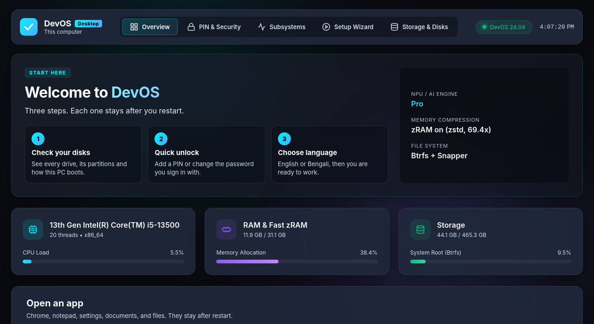
</p>

- **Real-Time Hardware Telemetry:** Live stats for CPU threads, RAM allocation, memory compression (**zRAM with zstd**, with the measured ratio shown), and Btrfs storage health.
- **First-Boot 3-Step Wizard:** Step-by-step guidance to inspect disks, configure fast PIN or password unlock, and select English or Bengali.
- **Storage & Boot Doctor:** Interactive partition manager detecting UEFI vs MBR standards, checking EFI health, discovering unformatted volumes, formatting partitions (btrfs, ext4, ntfs, fat32, exfat), and solving storage problems with one click.
- **Subsystem & Runtime Center:** Monitor and launch local PHP/MariaDB web dev stacks, the Windows `.exe` Wine layer, Android `.apk` subsystem, and local AI coding assistants.

<p align="center">
  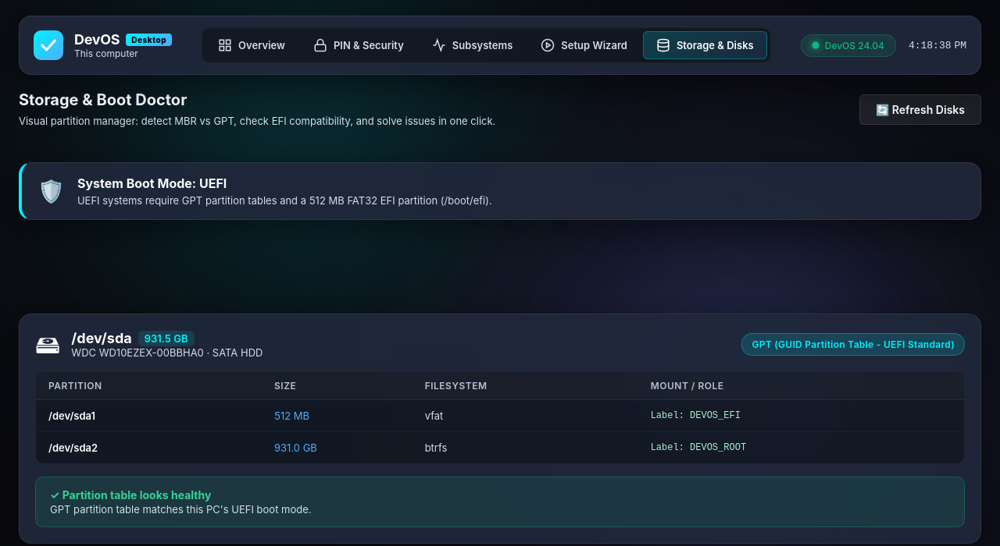&nbsp;&nbsp;
  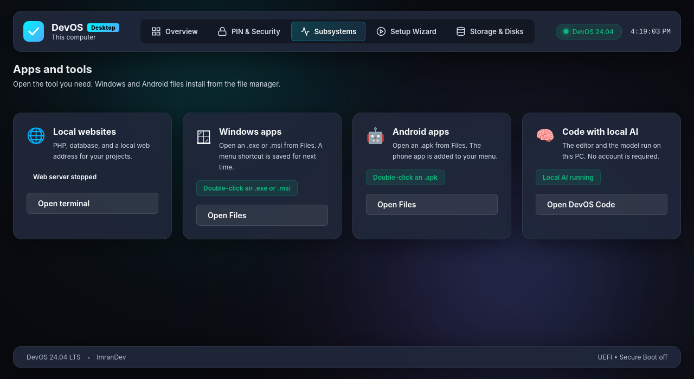
</p>

<p align="center">
  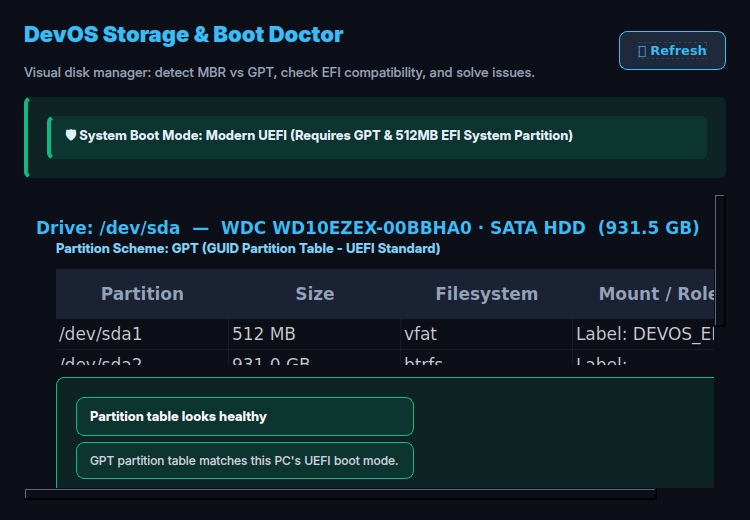
  <br><em>DevOS Storage & Boot Doctor: partition health diagnostics, unformatted volume discovery, filesystem formatting, and Btrfs snapshot management.</em>
</p>

### 16. Built-in productivity & AI everywhere
- **DevOS Notes** — notebooks, sticky notes on the desktop, voice notes, AI summarize / to-do / translate; saved in Documents.
- **Voice typing (Win+Alt+H)** — dictate into any app in Bangla or English, offline.
- **AI on any text (Win+Alt+A)** — select text anywhere → rewrite, fix grammar, shorten, translate, summarize, reply.
- **Clipboard history (Win+V)** — the copies you already made, one click to paste one back into the app you were using.
- **Emoji panel (Win+.)** — search “love”, “laugh”, “food” or “bd” and it pastes the emoji. Say “open emoji” to DevOS AI.
- **DevOS AI Code Agent** — a Cursor-style coding agent on the local model: plans, reads code, shows every change as a diff to accept, asks before running commands. Appears only on PCs with 8 GB+ RAM and a Medium+ or Coding AI model.
- **Install anything:** paste a Microsoft Store, Google Play, App Store or Flathub link (or say "install Zoom") and DevOS AI finds the DevOS version, the web version, or tells you honestly when an app can't run on DevOS.
- DevOS's own tools (Dashboard, Storage Doctor…) open in their **own DevOS windows**, not browser tabs.

### 17. Cloud Backup — optional Google Drive / OneDrive
- **Off by default.** Turn it on, sign in to Google Drive or OneDrive in your browser, and pick Documents, Desktop, Pictures and/or Downloads.
- DevOS creates `DevOS/<your PC>/Documents…` in your cloud and backs up new and changed files every 30 minutes and soon after a download finishes. Deleting a file on the PC never deletes the cloud copy.
- **Restore** brings your files back on any DevOS PC; or download them from drive.google.com / onedrive.live.com. Google Drive access is limited to files DevOS created. Your password is never seen by DevOS.

---

## System requirements

| | Minimum | Recommended |
|---|---|---|
| Processor | 64-bit (x86-64), 2 cores | 4+ cores |
| Memory | 4 GB | **8 GB** (for Android apps + AI + browser at the same time) |
| Storage | 30 GB | 64 GB+ SSD |
| Firmware | UEFI or legacy BIOS | UEFI |
| Graphics | Any | Intel or AMD (hardware-accelerated Android apps) |

---

## 💿 Download ISO & Easy Installation Guide (For Everyone)

You do **not** need to be a developer or Linux expert to install and run DevOS. Follow these 4 easy steps:

---

### Step 1: Download the DevOS ISO File
- 🔗 **Google Drive Direct Download:** [**Click here to Download DevOS ISO (Google Drive)**](https://drive.google.com/drive/folders/1RHM8niXwkPsqzOkiMxxp4tpf41bnyJ01?usp=sharing)
- **File size:** varies by release; use the size and checksum published with that ISO.
- **What you need:** A USB flash drive (8 GB or larger). *Note: Back up any important files on the USB drive, as flashing will erase it.*

---

### Step 2: Make a Bootable USB Flash Drive (Takes ~3 minutes)

Choose whichever tool is easiest for you:

#### Option A: Rufus (Easiest for Windows users)
1. Download [Rufus](https://rufus.ie/) (free, portable application — no installation required).
2. Insert your USB flash drive into your computer.
3. Open Rufus:
   - Under **Device**, select your USB drive.
   - Under **Boot selection**, click **SELECT** and choose the downloaded `devos-26.04-amd64.iso` file.
   - Click the **START** button at the bottom.
   - If a prompt asks for write mode, choose **"Write in DD Image mode"** and click **OK**.
4. Wait until the progress bar reaches 100% and displays **Ready**.

#### Option B: balenaEtcher (Windows, Mac, or Linux)
1. Download and install [balenaEtcher](https://etcher.balena.io/) (free).
2. Open balenaEtcher and plug in your USB drive.
3. Click **Flash from file** and select the downloaded `devos-26.04-amd64.iso`.
4. Click **Select target** and pick your USB stick.
5. Click **Flash!** and wait for verification to complete.

*(Advanced Linux/macOS users can also use `sudo dd if=devos-26.04-amd64.iso of=/dev/sdX bs=4M status=progress oflag=sync`)*

---

### Step 3: Boot your PC from the USB

1. **Turn off Secure Boot** in your PC's BIOS / UEFI settings:
   - Restart your computer and press the BIOS key right as it powers on (usually **F2**, **F12**, **Del**, or **Esc** depending on your computer brand).
   - Navigate to the **Security** or **Boot** tab, set **Secure Boot** to **Disabled**, then save and exit.
2. **Open the Boot Menu**:
   - Turn on your computer and immediately tap your brand's Boot Menu key:
     - **Dell / Lenovo:** `F12`
     - **HP:** `F9` or `Esc`
     - **Asus / Acer:** `F8` or `F12`
     - **MSI / Gigabyte:** `F11` or `F12`
   - Select your **USB drive** from the list and press **Enter**.

---

### Step 4: Try or Install DevOS

- **Try it first without touching your hard drive (Live Session):** DevOS boots directly to the desktop. You can test Wi-Fi, audio, the browser, and DevOS AI before installing.
- **Install permanently to your PC:**
  1. The **DevOS Installer** opens automatically on the desktop.
  2. Follow the friendly prompts: **Welcome → Location & Language → Keyboard → Partitions → Account → AI → User type → Apps → Summary**.
  3. Under *Partitions*, select:
     - **Erase disk:** Best for a clean system; sets up high-speed compressed storage automatically.
     - **Manual partitioning / alongside (when offered):** Choose an appropriate dual-boot layout and review the summary before writing changes. Back up existing data first.
  4. Create your account name (password is optional; if left blank, DevOS signs in automatically).
  5. Review the summary, then click **Install**. Installation time depends on the drive, hardware and selected downloads.
  6. When finished, restart your PC and remove the USB drive when the screen turns off.

---

### 🧪 Try it first in Docker (Windows, Docker Desktop)
Want to test DevOS right from your existing Windows desktop without restarting?
```bash
powershell -ExecutionPolicy Bypass -File .\tests\docker-vm\run-devos-vm.ps1 -Reset
```
Then open **http://localhost:8006** in your browser. The VM uses a virtual disk (`tests/docker-vm/storage`) — your real hard drives are untouched. See [`tests/docker-vm/README.md`](tests/docker-vm/README.md).

---

## Build the ISO from source

The current source targets **Ubuntu 26.04 LTS (Resolute)**. Existing download links
above refer to previously published releases until a new ISO is released.
See [DevOS updates and the Ubuntu upgrade helper](docs/UPDATES.md).

Requirements: Docker or Podman, or an Ubuntu 26.04 host, ~25 GB free space, internet.

```bash
git clone https://github.com/imranbru99/DevOS.git
cd DevOS
make iso-docker          # containerized build -> out/devos-26.04-amd64.iso
```

Manual container build (keeps a reusable build cache so rebuilds take ~25 minutes):
```bash
docker build -t devos-builder:26.04 -f build/docker/Dockerfile.build .
docker run --rm --privileged \
  -e DEVOS_WORK_DIR=/build_work -e DEVOS_ZSTD_LEVEL=19 \
  -v devos-work:/build_work -v "$PWD:/workspace" -w /workspace \
  devos-builder:26.04 bash ./build/build-iso.sh
```

Useful options: `DEVOS_ISO_NAME` (output file name), `DEVOS_ZSTD_LEVEL` (15 = faster build, 19 = smaller ISO), `UBUNTU_MIRROR`. The build fails on purpose if the ISO exceeds 4 GB or if any system file is world-writable.

**Tests**
```bash
python3 -m unittest discover -s tests/unit
```

---

## Command line

```bash
devos update                                # latest stable DevOS release from GitHub
devos update --check                        # check for a new DevOS component release
devos update --version TAG                  # choose a published stable release
devos update --os-upgrade                   # interactive Ubuntu LTS upgrade
devos app install <file.exe|file.apk|file.deb>   # install / run any app
devos app search <name>                          # search the app catalog
devos win launch <app.exe>                       # run a Windows program
devos win doctor <app.exe>                       # compatibility check
devos android setup                              # one-time Android download
devos android install <app.apk>                  # install an Android app
devos serve new myapp --stack laravel            # scaffold a project (laravel | nextjs | fastapi)
devos serve status                               # local developer services
devos ai "find files larger than 100MB"          # system assistant
devos net | devos sound | devos driver | devos disk   # network, audio, drivers, storage
devos watchdog --check-pressure                  # memory pressure check
devos models list                                # AI models for this PC (devos-ai-models)
devos models api lan on                          # share the local AI API on your network
devos auto commit                                # commit subject from the local model
devos link                                       # Phone Link window (devos link pair-code)
devos share start 3000                           # public https link for a local server
devos backup                                     # optional Google Drive / OneDrive backup
devos agents capacity                            # how many AI agent browsers stay smooth
devos agents open research --url https://example.com
devos features list                              # every optional app and feature
devos task                                       # Task Manager
devos vault                                      # encrypt a folder
devos restore                                    # btrfs restore points
devos-security check https://example.com         # look-alike and scam check
devos-clipboard                                  # clipboard history (Win+V)
devos-emoji                                      # emoji panel (Win+.)
devos-islamic today                              # today's prayer times, Hijri date, ayah & hadith
sudo devos-modesty enable --mode women           # optional local body-region filter (estimates may be wrong)
devos-kids-mode                                  # launch the full-screen space playground
devos-broadband                                  # PPPoE / direct ONU broadband connection
devos-disk-gui                                   # Storage & Boot Doctor
devos-display                                    # display resolution, refresh and scale
devos-power                                      # power profiles and sleep timeouts
devos-files                                      # Files / This PC
devos-archive                                    # archive helper; see --help
devos-ai-code-agent                              # DevOS AI Code Agent GUI
devos-familysafe                                 # Family safety and content guard
```

---

## Repository layout

```
DevOS/
├── build/
│   ├── build-iso.sh                 # Builds the hybrid BIOS + UEFI ISO
│   ├── docker/Dockerfile.build      # Reproducible build container
│   ├── package-lists/               # Packages (base, hardware, desktop, apps, installer, developer, Wine, Android)
│   ├── hooks/                       # Clean-up, services, performance, branding
│   └── includes.chroot/             # Files placed into the system (installer branding, desktop, scripts)
├── components/
│   ├── assistant/                   # DevOS AI app: chat window, commands, voice, documents, photos
│   ├── ai-core/                     # Local AI service (OpenAI-compatible API on 127.0.0.1:11434)
│   ├── apps/                        # Apps window (uninstall, cache, cookies)
│   ├── optimizer/                   # DevOS Optimizer (idle apps, clean-up)
│   ├── taskman/                     # Task Manager (Ctrl+Shift+Esc)
│   ├── notepad/                     # Notepad with crash-proof sessions
│   ├── apphub/                      # App routing, safety scan, native-version catalog
│   ├── winlayer/                    # Windows programs
│   ├── androidlayer/                # Android apps
│   ├── devserver/ code-agent/ ai-agent/ settings/ dashboard/ first-boot/ linuxlayer/
│   └── devos_cli.py                 # `devos` command
├── tests/
│   ├── unit/                        # Automated tests
│   └── docker-vm/                   # Run the ISO in Docker Desktop
├── tools/wallpapers/                # Wallpaper generator + preview
└── docs/                            # Guides (coming from Windows, compatibility, performance…)
```

---

## Known limitations

- **Secure Boot:** keep it disabled for this custom image unless that exact release has a verified signed boot chain. Including Ubuntu signed packages alone does not establish Secure Boot support.
- **Android apps** need the one-time ~850 MB download and an installed system (not the live USB). Play Services are a separate first-time choice (`devos android setup-play`). ARM-only apps may not run.
- **Windows apps:** most everyday programs work; games with kernel anti-cheat, drivers and some remote-control tools don't (DevOS offers native versions where they exist).
- **DevOS AI's built-in model is small:** great for commands and PC questions, simpler for open conversation — turn on *Smarter DevOS AI* for better answers. Voice recognition quality depends on your microphone.
- Window title bars still show some programs' own names.
- Google Chrome asks you to accept Google's terms on first launch.

For prototype status and implementation limits, see [architecture and roadmap](docs/MODERN_2027_OS_ARCHITECTURE.md).

## Roadmap

- Verified NPU inference backends (current NPU code detects hardware and recommends routing)
- ARM-app translation for Android APKs that only contain ARM code
- Broader Wayland coverage for display, input and power helpers
- More native-version matches

---

## Privacy & licensing

- **Local by default:** DevOS assistant, voice and document features process locally. The Code Agent supports cloud providers and can select one when a supported API key is configured; prompts and relevant code then go to that provider. Web searches, public sharing, optional cloud backup, downloads and third-party apps have their own network behavior and terms.
- DevOS's own code is released under the **MIT License** ([`LICENSE`](LICENSE)).
- DevOS includes open-source components under their own licenses (Ubuntu packages, KDE Plasma, Calamares, Wine, Waydroid, llama.cpp, whisper.cpp, and the open-weight Qwen2.5 and SmolVLM models), plus **Google Chrome** and **Microsoft Visual Studio Code**, which are distributed under their vendors' terms. See [`THIRD_PARTY_NOTICES.md`](THIRD_PARTY_NOTICES.md) and [`LICENSES/`](LICENSES/).
- DevOS is not affiliated with Microsoft, Google or Canonical. The Android system is open-source LineageOS without Google services.

---

## 🤝 Let's Connect & Collaborate

DevOS is created and maintained by **Imran Ahmed (Imran Dev)**. Contributions, issues and ideas are welcome on [GitHub](https://github.com/imranbru99/DevOS).

I am open to **Senior Remote Full-Stack Roles, AI Platform Architecture Contracts, and Enterprise Technical Advisory**.

- **Timezone:** UTC+6 (Dhaka / Rangpur, Bangladesh) — Flexible overlap with US, UK, and European business hours.
- **Delivery Mode:** Async-ready, Slack, Discord, Jira, GitHub, and production-first accountability.

| Channel | Address / Handle | Quick Action |
|---|---|---|
| 🌐 **Primary Portfolio** | [imrandev.bd](https://imrandev.bd/) | [Visit Site ↗](https://imrandev.bd/) |
| 📦 **Packagist Packages** | [packagist.org/packages/imrandevbd/](https://packagist.org/packages/imrandevbd/) | [View Packages ↗](https://packagist.org/packages/imrandevbd/) |
| 💼 **LinkedIn Profile** | [linkedin.com/in/imranbru99](https://linkedin.com/in/imranbru99) | [Connect ↗](https://linkedin.com/in/imranbru99) |
| 🐙 **GitHub Profile** | [github.com/imranbru99](https://github.com/imranbru99) | [Follow ↗](https://github.com/imranbru99) |
| 💬 **WhatsApp Direct** | [+880 1576-918420](http://wa.me/+8801576918420) | [Chat Now ↗](http://wa.me/+8801576918420) |
| 📧 **DevOS Email** | [devos@imrandev.bd](mailto:devos@imrandev.bd) | [Send Email ↗](mailto:devos@imrandev.bd) |
| ✉️ **Contact Form** | [imrandev.bd/contact](https://imrandev.bd/contact) | [Get in touch ↗](https://imrandev.bd/contact) |
| 🐦 **X (Twitter)** | [@imrandev_bd](https://x.com/imrandev_bd) | [Follow ↗](https://x.com/imrandev_bd) |
| 📺 **YouTube Tech** | [@ImranDevBD](https://youtube.com/@ImranDevBD) | [Subscribe ↗](https://youtube.com/@ImranDevBD) |

---

**DevOS** © 2026 Imran Ahmed. Released under the [MIT License](LICENSE).
